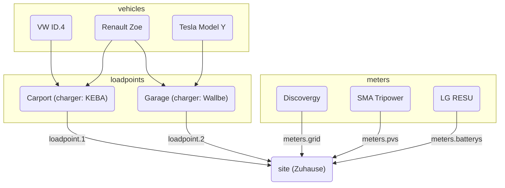

evcc si può configurare in due modi:

**1. Configurazione tramite interfaccia (consigliata)**

La configurazione avviene nell’interfaccia web, alla voce **Configurazione**.
Le impostazioni vengono salvate automaticamente nel database.
Per maggiori informazioni, vedi [Configurazione](/it/installation/configuration).

**2. Configurazione tramite file**

La configurazione tramite il file `evcc.yaml` resta supportata.
Questa sezione documenta la configurazione basata su YAML.

:::note[Uso in parallelo]
I due metodi di configurazione si possono usare in parallelo.
I dispositivi (punti di ricarica, contatori, impianti fotovoltaici, batterie domestiche, veicoli) vengono uniti da entrambe le fonti.
Per le altre impostazioni ha la precedenza la configurazione tramite interfaccia.
I dettagli si trovano nelle [FAQ](/it/faq#ui-migration).
:::

## Configurazione tramite file (evcc.yaml)

Il file di configurazione è scritto in formato YAML e per impostazione predefinita si chiama `evcc.yaml`.
Si trova nella stessa directory di evcc oppure, sui sistemi POSIX (ad es. Linux), in `/etc/evcc.yaml`.

All’avvio si possono indicare percorsi diversi: `evcc -c /path/to/evcc.yaml`

### Struttura

Il file di configurazione contiene più sezioni.
Per fare riferimento da una sezione all’altra, i dispositivi hanno un parametro `name` che li identifica.

Un file di esempio con molti parametri si trova qui:
https://github.com/evcc-io/evcc/blob/master/evcc.dist.yaml

Ecco una panoramica delle relazioni tra le parti più importanti della
configurazione:

### Come funziona evcc? (uno sguardo all’interno)

Perché il sistema funzioni è importante un contatore di rete (contatore `grid`).
Questo determina la potenza in surplus attuale.
La misura della potenza prodotta non influisce sulla regolazione.
È possibile anche usare evcc senza contatore di rete, vedi le [FAQ](/it/faq#configuration).

La potenza in surplus viene confrontata con la potenza minima necessaria per la ricarica. Se
è sufficiente, la ricarica viene avviata.

La potenza minima necessaria per la ricarica si calcola dai valori `minCurrent`
e `phases`, definiti per ogni `loadpoint` (un gruppo di caricabatterie nello stesso luogo).
Vedi [`loadpoints`](/it/reference/configuration/loadpoints) per maggiori
informazioni.

Ad esempio: `phases: 1` e `minCurrent: 8`

1 (fasi) × 8 A (minCurrent) × 230 V (tensione di rete) = 1.840 W (potenza minima necessaria per la ricarica)

#### Possibilità di intervento

Normalmente la potenza in surplus corrisponde alla potenza di ricarica disponibile.
La potenza di ricarica disponibile si può però regolare individualmente con
diversi parametri. Sono i seguenti:

- Sito: `residualpower`
- Sito: `prioritySoc`
- Sito: `bufferSoc`
- Sito: `aux`
- Punto di ricarica: `enable: threshold`
- Punto di ricarica: `disable: threshold`

Per le impostazioni disponibili, consulta la descrizione di ciascun
parametro.

- [Parametri di configurazione del sito](/it/reference/configuration/site)
- [Parametri di configurazione del punto di ricarica](/it/reference/configuration/loadpoints)

### Sito

Un [sito](/it/reference/configuration/site) descrive l’impianto domestico con i dispositivi necessari
e regola la potenza disponibile.

### Punto di ricarica

Un [punto di ricarica](/it/reference/configuration/loadpoints) descrive l’infrastruttura di ricarica e riunisce
i _caricabatterie_ e i _veicoli_ presenti e tutto ciò di cui un punto di ricarica ha bisogno.

### Caricabatterie

[Caricabatterie](/it/reference/configuration/chargers) contiene un elenco di caricabatterie e delle loro proprietà, ad es.
come vengono indirizzati.

### Contatori

[Contatori](/it/reference/configuration/meters) è un elenco di dispositivi che misurano diversi flussi di potenza. Tra
questi:

- Potenza prelevata e immessa
- Potenza prodotta dall’impianto fotovoltaico
- Corrente di ricarica dell’auto elettrica (se il caricabatterie non la fornisce direttamente)
- Flusso di potenza della batteria domestica o delle batterie domestiche

### Dispositivi limitatori

I [dispositivi limitatori](/it/reference/configuration/curtailers) limitano solo l’immissione in rete dell’impianto
fotovoltaico su richiesta del gestore di rete (§ 9 EEG), ad es. lo SMA Sunny Home Manager 2.0 o l’inverter
principale di un impianto con più inverter.

### Veicoli

Per limitare il livello di carica delle auto elettriche a un valore specifico, qui puoi indicare
i tuoi [veicoli](/it/reference/configuration/vehicles) e le credenziali del rispettivo account online.

### HEMS

evcc può inoltrare i punti di ricarica e le relative correnti di ricarica a un altro
[sistema di gestione energetica domestica (HEMS)](/it/reference/configuration/hems), che può usare queste
informazioni ad es. per controllare la batteria domestica.

### Notifiche

In questa sezione puoi definire gli eventi di cui vuoi essere informato. Per
l’invio dei messaggi sono supportati molti sistemi diversi.

[Maggiori informazioni](/it/reference/configuration/messaging)
