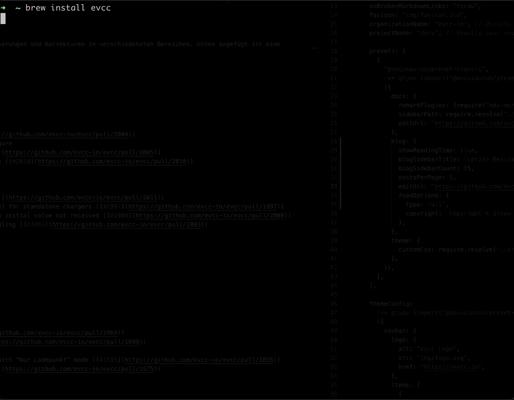

Er is de afgelopen weken veel gebeurd. Daarom vertellen we vandaag wat uitgebreider wat er in versie 0.72 allemaal nieuw is.

<!-- excerpt -->

## Eenvoudigere installatie

Voor **evcc** was tot nu toe toch wel wat technische kennis van het betreffende besturingssysteem nodig. Voor Linux (Debian, Ubuntu, Raspberry Pi OS) en macOS is de installatie nu flink vereenvoudigd. Zo ondersteunt **evcc** nu de installatie via de pakketbeheerders `apt` onder Linux en [`homebrew`](https://brew.sh) onder macOS.

Daarvoor hebben we de installatiehandleidingen herzien en de installatie verder vereenvoudigd. Neem gerust een kijkje in de [bijbehorende documentatie](/nl/installation).

## Eenvoudigere configuratie

Ook het instellen van **evcc** was tot nu toe nog erg technisch. Denk aan de opmaakregels van [YAML](https://yaml.org), dat de syntaxis van de configuratie bepaalt, of aan het opzetten en aanpassen van de configuratie van uw eigen apparaten in het configuratiebestand. Voor sommigen zijn dat behoorlijk hoge drempels. Maar het project is nog jong en het team klein, zeker als u bedenkt dat dit voor de ontwikkelaars “maar” een hobby is.

Om die drempels wat te verlagen, introduceren we met deze nieuwe versie 0.72 van **evcc** een nieuwe functie: de begeleide configuratie met `evcc configure`.

Met deze opdracht kunt u interactief een werkend configuratiebestand voor uw eigen installatie aanmaken! Er zijn hier en daar vast nog wat problemen en fouten, maar we hopen dat het een goede eerste stap in de juiste richting is.

## Download & installatie

- [Debian, Ubuntu, Raspberry Pi](/nl/installation/linux)
- [macOS Homebrew](/nl/installation/macos)
- [Docker](/nl/installation/docker)
- [Windows](/nl/installation/windows)

## Changelog

### Versie 0.72

- [Gedetailleerde lijst met wijzigingen](https://github.com/evcc-io/evcc/releases/tag/0.72)

### Versie 0.71

- [Gedetailleerde lijst met wijzigingen](https://github.com/evcc-io/evcc/releases/tag/0.71)
