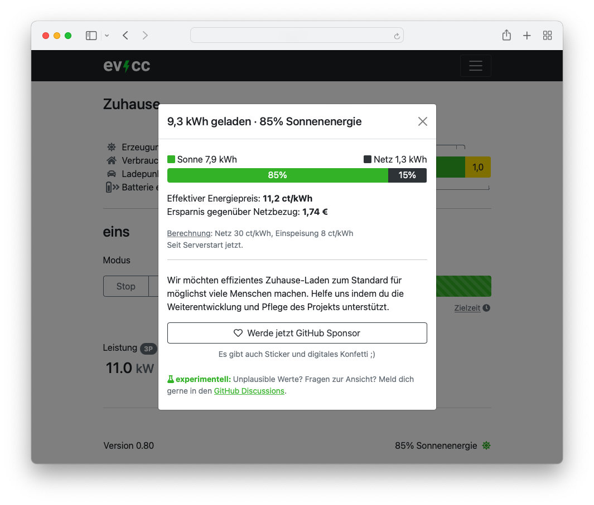

Ook dit jaar gaan we door met nieuwe updates :) Naast de kleinere updates met 0.78 en 0.79 zijn er nu met versie 0.80 ook een paar grotere wijzigingen.

<!-- excerpt -->

## Verbeteringen aan `evcc configure`

Wie een configuratie met `evcc configure` aanmaakt, wordt eerst gevraagd naar uw kennisniveau. Zo kunnen gevorderde gebruikers de configuratie op technische punten wat nauwkeuriger instellen. De geavanceerde modus is ook nog steeds rechtstreeks beschikbaar via `evcc configure --advanced`. Voor beginners raden we deze modus echter niet aan, omdat er meer kennis voor nodig is.

Daarnaast zijn er meer apparaattemplates, correcties aan bestaande templates en extra instelmogelijkheden.

## Aandeel zonne-energie en besparing

De nieuwe besparingsfunctie laat zien hoeveel van de geladen energie uit uw eigen zonne-energie kwam.
Het percentage wordt rechtsonder in de hoek weergegeven.
Als u erop klikt, krijgt u in een venster meer details te zien.
Daar ziet u naast de hoeveelheid energie ook uw effectieve energieprijs en de totale besparing ten opzichte van alleen netafname.
Meer informatie over de [berekening en prijsconfiguratie](/nl/faq#savings-calculation) vindt u hier.

[Sponsors](/nl/sponsorship) vinden in het nieuwe venster onder de bedankknop met confetti, _\*tromgeroffel\*_, een link naar onze nieuwe evcc-stickers.
U bent geweldig. Bedankt voor uw steun! 💚🥳

## Docker

Wie Docker gebruikt, kan nu via de tag `latest` steeds de actuele versie gebruiken. Met de tag `nightly` zijn er dagelijks nieuwe builds, die echter mogelijk nog minder goed getest zijn. Meer informatie over de installatie met Docker vindt u hier: [Docker, Synology](/nl/installation/docker)

## Bugfixes

Deze versie bevat natuurlijk weer een reeks bugfixes en veel kleine verbeteringen. Een gedetailleerd overzicht vindt u via de changelog-link hieronder.

## Download & installatie

- [Debian, Ubuntu, Raspberry Pi](/nl/installation/linux)
- [macOS Homebrew](/nl/installation/macos)
- [Docker](/nl/installation/docker)
- [Windows](/nl/installation/windows)

## Changelog

### Versie 0.80

- [Gedetailleerde lijst met wijzigingen](https://github.com/evcc-io/evcc/releases/tag/0.80)

### Versie 0.79

- [Gedetailleerde lijst met wijzigingen](https://github.com/evcc-io/evcc/releases/tag/0.79)

### Versie 0.78

- [Gedetailleerde lijst met wijzigingen](https://github.com/evcc-io/evcc/releases/tag/0.78)
