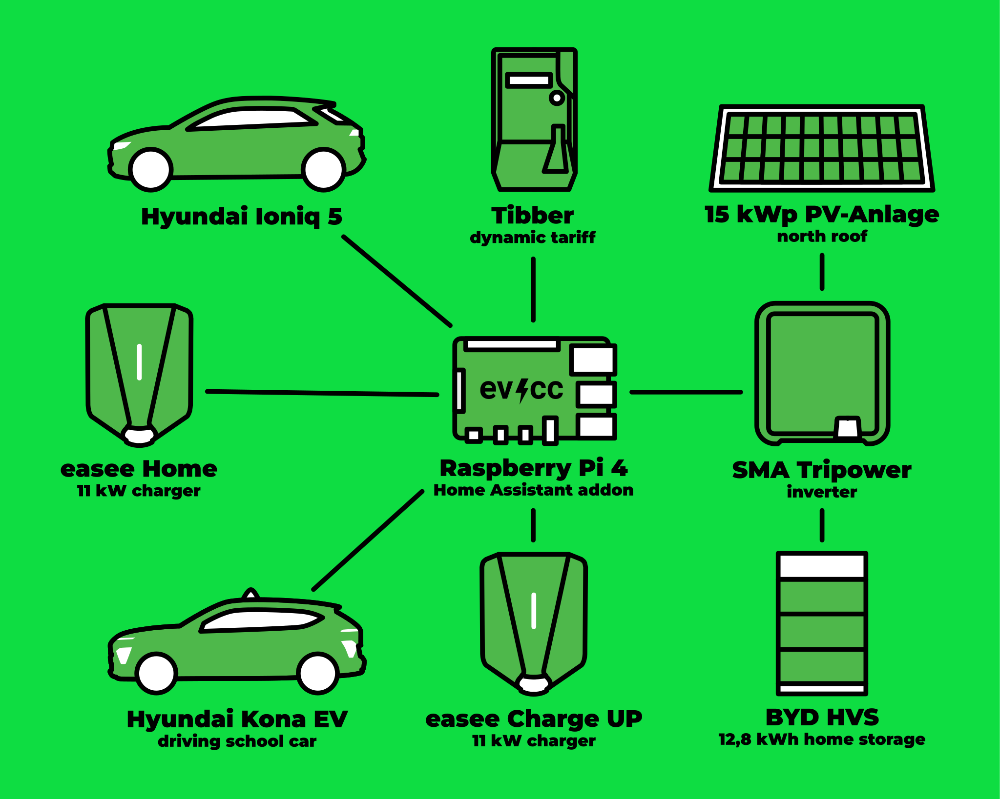
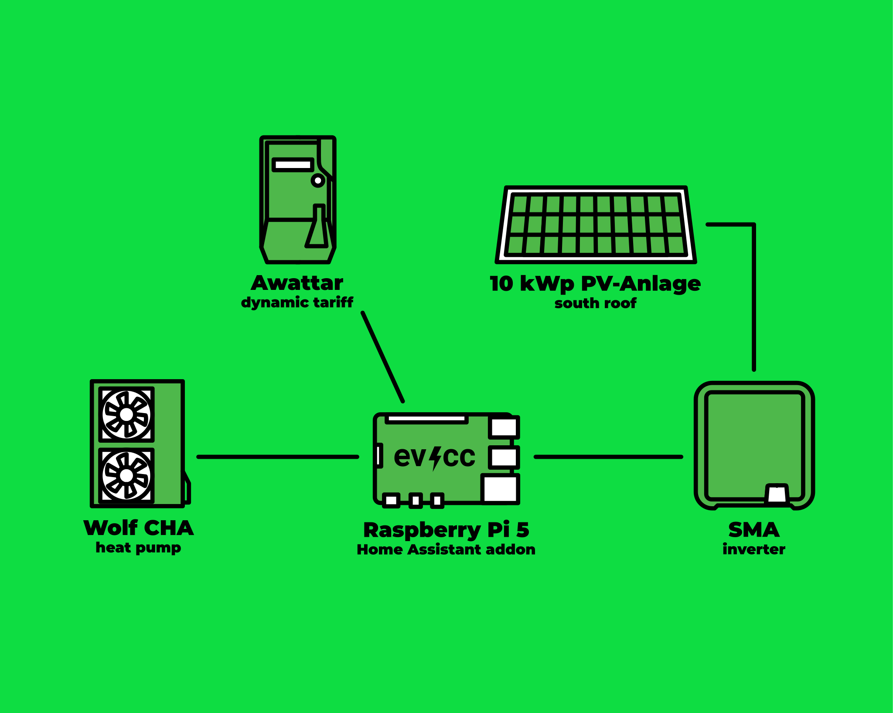

Alex is rijinstructeur en gebruikt al jaren elektrische voertuigen voor de rijopleiding.
Met evcc stuurt hij twee laders aan voor zijn privé- en bedrijfsvoertuigen, en hij is van plan een Wolf-warmtepomp voor zijn pand met vijf wooneenheden te integreren.
Fotograaf [Detlef](https://hee.se) ging bij hem op bezoek.

{/* excerpt */}

## Van deelauto i3 naar IONIQ 5

**Michael:** Hallo Alex, fijn dat u de tijd neemt.
U bent rijinstructeur en gebruikt elektrische auto’s beroepsmatig.
Wat was uw eerste kennismaking met elektrisch rijden?

**Alex:** Hoi Michael, graag.
Mijn eerste kennismaking met elektrisch rijden was in 2015 tijdens korte uitstapjes naar Hamburg.
Daar leerde ik via het autodeelplatform DriveNow de BMW i3 kennen.
Technisch interessant, opvallend door de carrosserie van koolstofvezel en heel wendbaar in het stadsverkeer.
Dat fascineerde me.

Medio 2021 kwam de eerste eigen elektrische auto, een geleasede VW ID.3.
In die tijd begon ik ook beroepsmatig elektrische voertuigen in te zetten voor de rijopleiding: ID.3, ID.4, Hyundai Kona.
Sinds ongeveer twee jaar rijden mijn vrouw en ik een Hyundai IONIQ 5.

**Michael:** Wat was uw motivatie om over te stappen?

**Alex:** Er waren meerdere redenen.
Het milieu: minder uitstoot, minder lawaai.
Dan de besparing: zonnestroom van mijn eigen dak in de thuisbatterij en daarna in de auto.
En dan het rijplezier.
De soepele acceleratie en het stille rijden zijn prettig.

## Elektrische auto’s in de rijschool

**Michael:** U bent al 17 jaar rijinstructeur in de regio Keulen/Bonn.
Welke rol speelt elektrisch rijden in uw dagelijkse werk?
Is er de afgelopen jaren iets veranderd?

**Alex:** Zeker.
Elektrisch rijden is in de rijschoolbranche nog niet helemaal ingeburgerd, maar de voordelen worden steeds vaker erkend.
Ik schat dat inmiddels 15 tot 20% van de lesauto’s elektrisch is, vergelijkbaar met privévoertuigen.

Er zijn ook collega’s die sceptisch staan tegenover de nieuwe mobiliteit.
Sommigen laten zich leiden door de bekende mythes: grondstofwinning, levensduur van de batterij, laadtijden, actieradius.
Maar de scepsis bij ouders is de afgelopen jaren merkbaar afgenomen.

**Michael:** Hoe reageren de leerlingen?

**Alex:** Veel ouders rijden inmiddels zelf elektrisch en staan open voor de nieuwe vorm van opleiding.
Het sleutelwoord is B197: 10 rijlessen van elk 45 minuten voor de bevoegdheid voor een handgeschakelde auto, de rest van de opleiding en het examen in een automaat.
De leerlingen vinden het fijn, omdat het examen ontspannener verloopt.
Typische fouten vallen weg: geen motor die afslaat, geen verkeerd schakelen, geen terugrollen bij het wegrijden op een helling.
Dat doet de ronde onder de leerlingen.

Slechts heel zelden zijn er ouders die per se een opleiding met alleen handgeschakelde auto’s willen.

## Waar is de peilstok?

**Michael:** Zijn er grappige verhalen uit het dagelijkse rijschoolleven met elektrische auto’s?

**Alex:** (lacht) O ja.
Een leerling was tijdens het examen wat zenuwachtig en ging samen met de examinator in de motorruimte op zoek naar de peilstok.
Zoiets vergeet ik niet.

**Michael:** En de actieradius?
Is die genoeg voor een normale rijschooldag?

**Alex:** Absoluut.
We kiezen voor de varianten met de grote batterij van 64 tot 77 kWh.
Zelfs in de winter werkt het.
Als we tussendoor voor de B197-opleiding overstappen op de handgeschakelde auto, kan ik in die tijd bij de rijschool 90 minuten met 11 kW bijladen.
Een snellader heb ik praktisch nooit hoeven gebruiken.

Thuis heb ik een aparte lader voor de bedrijfsauto.
Zo begin ik de dag altijd met een volle batterij.

## Van Tibber Smart Charging naar evcc

**Michael:** Hoe bent u bij evcc terechtgekomen?

**Alex:** In het voorjaar van 2023 heb ik me verdiept in HEMS-systemen.
Mijn oorspronkelijke doel was een dynamisch stroomtarief te combineren met laden op de goedkoopste momenten.
Tibber legde daarvoor de basis met Smart Charging.

Na de installatie van het zonnepanelensysteem en de thuisbatterij was deze aansturing niet meer voldoende.
De flexibiliteit van evcc sprak me aan: meldingen, tariefintegratie, brede ondersteuning voor laders en voertuigen.
Ik steun de voortdurende ontwikkeling graag.

**Michael:** Welke functies gebruikt u concreet?

**Alex:** Ik gebruik geautomatiseerde laadplannen voor privé- en bedrijfsvoertuigen tot een bepaald laadniveau in de vroege ochtend.
Mijn doel is dat het systeem werkt zonder dat ik veel hoef in te grijpen.
Aan de laatste fijnafstemming sleutel ik natuurlijk graag, maar in het dagelijks leven moet het gewoon werken.

## Twee systemen, twee Raspberry Pi’s

**Michael:** Laten we het over uw technische opstelling hebben.
U hebt een wat ongebruikelijke configuratie.

**Alex:** Klopt, ik draai eigenlijk twee aparte evcc-installaties.
Het eerste systeem is voor mijn appartement.
Ik heb een zonnepanelensysteem van 14,85 kWp aan de noordkant van het dak, gecombineerd met een BYD-thuisbatterij van 12,8 kWh.
Er zijn twee Easee-laders aangesloten: één privé, één voor de bedrijfsauto.
Het dynamische stroomtarief loopt via Tibber.

Het systeem draait op een Raspberry Pi 4 met Home Assistant en de evcc-app.

| Component                  | Details                                    |
| -------------------------- | ------------------------------------------ |
| **Zonnepanelensysteem**    | 14,85 kWp (noordelijke oriëntatie)         |
| **Omvormer**               | SMA Sunny Tripower SE STP10.0-3SE-40       |
| **Thuisbatterij**          | BYD HVS 12,8 kWh LFP                       |
| **Laders**                 | Easee Home (11 kW), Easee ChargeUp (11 kW) |
| **Voertuigen**             | Hyundai IONIQ 5                            |
| **Dynamisch stroomtarief** | Tibber                                     |
| **Aansturing**             | Raspberry Pi 4, Home Assistant, evcc-app   |

**Michael:** En het tweede systeem?

**Alex:** Het tweede systeem is voor het hele pand met vijf wooneenheden.
Daar heb ik een zonnepanelensysteem van 10 kWp aan de zuidkant van het dak en een Wolf CHA 20/24, een lucht-waterwarmtepomp in monoblockuitvoering met SG Ready-interface.
Het stroomtarief loopt via Tado/awattar.

Het draait op een Raspberry Pi 5, ook met Home Assistant en de evcc-app.
De warmtepomp is nog niet volledig in evcc geïntegreerd, dat is mijn volgende project.

| Component                  | Details                                  |
| -------------------------- | ---------------------------------------- |
| **Zonnepanelensysteem**    | 10 kWp (zuidelijke oriëntatie)           |
| **Omvormer**               | SMA Sunny Tripower STP 10000TL-20        |
| **Warmtepomp**             | Wolf CHA 20/24 monoblock, SG Ready       |
| **Dynamisch stroomtarief** | Tado/awattar                             |
| **Aansturing**             | Raspberry Pi 5, Home Assistant, evcc-app |

## Planner en batterijboost

**Michael:** Wat zijn uw favoriete functies in evcc?

**Alex:** Zonder twijfel de planner voor specifieke weekdagen.
Ik kan per voertuig verschillende laadtijden instellen.
Dat loopt volledig automatisch.

En dan de batterijboost.
Als de thuisbatterij vol is, pomp ik overdag de zonnestroom uit de thuisbatterij direct in de auto, het liefst in de zomer tijdens een pauze. Geweldig.

**Michael:** Wat zou u nog van evcc willen?

**Alex:** Mijn verlanglijst wordt door de voortdurende ontwikkeling steeds korter.
Een native integratie van mijn warmtepomp zou mooi zijn.
Twee Wolf-systemen worden ondersteund, maar de CHA nog niet.
De community op GitHub helpt altijd goed bij problemen die opduiken.

De integratie van huishoudelijke apparaten zoals Miele@home of BSH Home Connect zou ook een logische ontwikkeling zijn, ook al gaat het hier maar om een paar kWh.
Ik ben het er echter ook mee eens dat het project de focus niet te veel moet verliezen en zich op de kernfuncties moet concentreren.

**Michael:** Bedankt voor de goede suggesties.
En hartelijk dank dat u ons een kijkje hebt gegeven in uw dagelijkse rijschoolleven en uw evcc-opstelling.
Het laat mooi zien hoe veelzijdig elektrisch rijden en evcc ingezet kunnen worden!

**Alex:** Graag gedaan!
En we zien elkaar in april op de [communitymeetup](/nl/blog/2025/12/16/community-treffen-2026) in Osnabrück.

---

**Hoe ziet uw evcc-opstelling eruit?**
Hebt u interesse om uw ervaringen, uw verhaal en uw techniek te delen in de vorm van een communityportret, meld u dan gerust aan via [dit formulier](https://airtable.com/appDI3xIiev1DOpMY/shrW1zGH26KElfZOK).
We zijn vooral op zoek naar portretten van bijzondere installaties of gebruikers buiten Duitsland.
