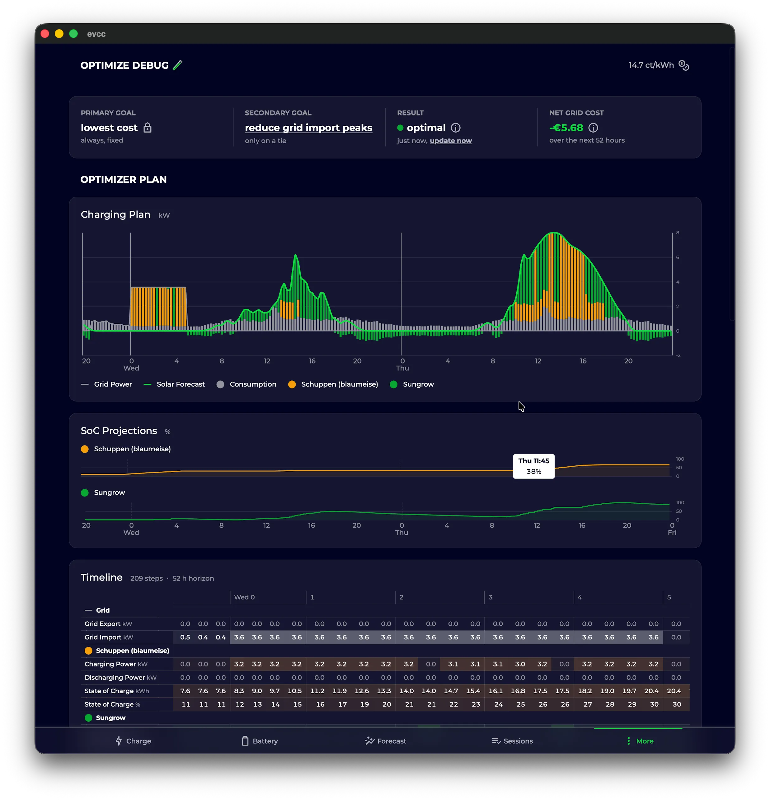
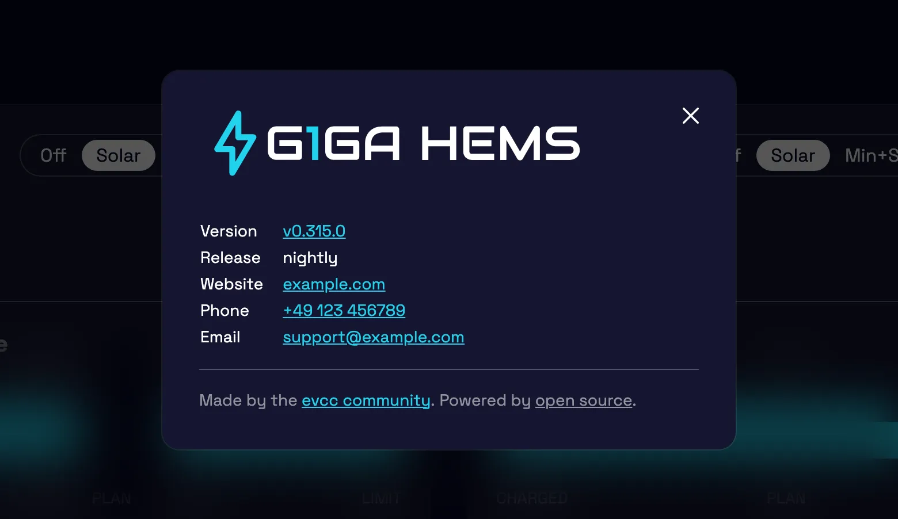

import Video from "@components/Video.astro";
import configUiVideo from "../../../../../en/blog/2026/08/19/config-ui-navigation.mp4";
import configUiPoster from "../../../../../en/blog/2026/08/19/config-ui-navigation.webp";

Slechts vier weken na de [vorige highlights-post](/nl/blog/2026/07/18/highlights-remote-access-widgets-optimizer) zijn we er weer.
Vroeger zaten er meestal enkele maanden tussen onze posts.
Dat willen we veranderen.
In deze blogpost geven we een overzicht van wat er nieuw is in evcc: het nieuwe releaseproces, voortgang van de optimizer, verbeteringen in de configuratie-interface, een aanpasbare interface en meer.

{/* excerpt */}

## Nieuw releaseproces

Tot nu toe publiceerden we releases met regelmatige tussenpozen.
Na elke release hielden we grotere wijzigingen en nieuwe functies een tijdje tegen, om te zien of er nog dringende bugfixes of regressies opdoken.
Daarna gaven we de grotere wijzigingen wat tijd in de nightly om feedback te verzamelen.
Dat gaf problemen zodra we snel een release moesten uitbrengen, bijv. omdat een autofabrikant zijn API had omgegooid.
Dan moesten we onafgemaakte functies tijdelijk terugdraaien, of ze kwamen iets minder uitgerijpt dan bedoeld bij u terecht 🙈.

Ons nieuwe model lost dit op: we maken nu expliciet onderscheid tussen bugfixes die snel uitgerold moeten worden en grotere functies die in de volgende feature-release komen.
Zo kunnen we [semantic versioning](https://semver.org) goed toepassen:

- **Feature-releases** zoals <code>0.<u>314</u>.0</code> verschijnen elke twee tot vier weken.
- **Bugfix-releases** zoals <code>0.314.<u>1</u></code> kunnen we er eenvoudig tussendoor uitbrengen.
- De **nightly** zoals <code>0.315.0<u>-dev.1787769000</u></code> bevat nog altijd de actuele stand van de `master`-branch, d.w.z. alle functies en bugfixes.

Alle ontwikkeling gebeurt nog steeds op `master`.
Nieuw is een `/backport`-commando op GitHub dat afzonderlijke pull requests uitkiest voor de volgende bugfix-release.
Een agent op basis van Claude neemt het proces over en lost eventuele conflicten op.

## Optimalisaties van de optimizer

Met de [optimizer](/nl/features/optimizer) werken we eraan het gedrag van uw hele energiesysteem voor de komende dagen te optimaliseren, op basis van voorspellingen van verbruik en productie en het verloop van de stroomprijs.
We noemden hem al in de [vorige highlights-post](/nl/blog/2026/07/18/highlights-remote-access-widgets-optimizer#optimizer).
De optimizer is nog experimenteel.
Op dit moment wordt het berekende plan alleen weergegeven: als aanbeveling bij het laadpunt, op de batterijpagina en op de [vernieuwde optimizer-pagina](https://github.com/evcc-io/evcc/pull/32837).
De volgende stap is dat de optimizer de aansturing van batterij en laadpunten daadwerkelijk overneemt; de [pull request](https://github.com/evcc-io/evcc/pull/32881) daarvoor is in voorbereiding.

Nieuw in deze release: de optimizer houdt rekening met de gegevens van de laadplannen en optimaliseert meerdere laadplannen samen; tot nu toe werd elk plan alleen afzonderlijk bekeken.
Daarnaast is er veel gebeurd:

- Hij meldt nu [of het berekende plan haalbaar is](https://github.com/evcc-io/evcc/pull/32632), bijv. of alle laaddoelen op tijd bereikt kunnen worden.
- Een [statische terugleverlimiet](https://github.com/evcc-io/evcc/pull/32541) kan worden ingesteld en wordt meegenomen in de optimalisatie.
- De [instelling voor laat opladen](https://github.com/evcc-io/evcc/pull/32872) (precondition) van het laadplan wordt meegenomen in de optimalisatie.
- Hij rekent direct opnieuw bij [een voertuigwissel en bij het aansluiten of loskoppelen](https://github.com/evcc-io/evcc/pull/32681).
- Laadpunten zonder bekende voertuigcapaciteit (bijv. met een gastvoertuig) dragen nu hun [gemeten laadvermogen als verbruik](https://github.com/evcc-io/evcc/pull/32681) bij; voorheen ontbraken ze volledig in de optimalisatie.
- Hij [plant geen laadvermogen meer in](https://github.com/evcc-io/evcc/pull/32633) zodra het voertuig vol is.

Probeer het eens: schakel de experimentele functies in onder **Configuratie → Experimenteel** en zet daarna de optimizer aan.
Bekijk de optimizer-weergave en ga na of het resulterende plan u aannemelijk lijkt.
We horen graag uw feedback.

## Verbeteringen in de configuratie-interface

De configuratie in de browser wordt steeds verder verfijnd:

- [Apparaten kunnen worden uitgeschakeld](https://github.com/evcc-io/evcc/pull/29455) zonder ze te verwijderen, bijv. wanneer een apparaat tijdelijk offline is of u uw installatie aan het omgooien bent.
- Vensters [waarschuwen bij het sluiten](https://github.com/evcc-io/evcc/pull/32826) als er niet-opgeslagen wijzigingen zijn.
- Energie- en vermogenswaarden kiezen automatisch een [passende eenheid](https://github.com/evcc-io/evcc/pull/32754).
- Op mobiel heeft de configuratiepagina een echte [sectienavigatie](https://github.com/evcc-io/evcc/pull/32810) gekregen in plaats van één lange lijst.

<Video
  src={configUiVideo}
  poster={configUiPoster}
  autoplay
  aspect="1 / 1"
  title="Sectienavigatie in de configuratie op mobiel"
/>

## De interface aanpassen

De interface kan nu worden aangepast: logo, merknaam, website, support-e-mailadres en telefoonnummer.
Dat is bijv. interessant voor elektriciens en installateurs die evcc in klantprojecten inzetten.
Is er een eigen support-e-mailadres ingesteld, dan gaan probleemmeldingen vanuit de UI naar uw support-e-mailadres in plaats van naar GitHub.
De [white-label-pagina](/nl/reference/white-label) legt uit welke opties er zijn en hoe u de interface met uw eigen CSS naar wens vormgeeft.

## Breaking changes en integraties

We hebben het formaat gewijzigd waarin voorspellings- en tariefgegevens via de API en MQTT worden gepubliceerd.
In plaats van uitgebreide objecten komen de gegevens nu als [compacte arrays met Unix-timestamps](https://github.com/evcc-io/evcc/pull/32391), en MQTT publiceert [één bericht per type voorspelling](https://github.com/evcc-io/evcc/pull/32716).
Het resultaat: veel kleinere payloads, sneller laden en minder bandbreedte, wat u vooral merkt in de app en bij trage verbindingen.

Dit is een breaking change.
Hartelijk dank aan alle maintainers van evcc-integraties die hun projecten al vóór de release hebben aangepast: [marq24](https://github.com/marq24) en [mkshb](https://github.com/mkshb) ([Home Assistant](/nl/smarthome/home-assistant)), [Newan](https://github.com/Newan) ([ioBroker](/nl/smarthome/iobroker)), [rdvnit](https://github.com/rdvnit) ([Homey](/nl/smarthome/homey)), [TheNinth7](https://github.com/TheNinth7) ([Garmin](/nl/smarthome/garmin)) en het team achter de [openHAB-binding](/nl/smarthome/openhab).
Het is geweldig om zo’n actief ecosysteem rond evcc te zien.

We hebben in de navigatie van de documentatie een nieuwe sectie **Smart home** toegevoegd die deze integraties behandelt.
Op de pagina [Meer geweldige projecten](/nl/smarthome/awesome) verzamelen we bovendien kleinere communityprojecten, van Grafana-dashboards tot een e-ink-display en een menubalk-app.
Hebt u een kleine tool, helper of integratie rond evcc gebouwd, draag die dan gerust via een pull request aan voor de lijst, zodat anderen die kunnen vinden.

## Kleinere verbeteringen

- **Nieuwe grafiek-engine:** De overstap van [Chart.js](https://github.com/chartjs/Chart.js) naar [Apache ECharts](https://echarts.apache.org) is afgerond; de ontwikkeling van Chart.js is helaas stil komen te liggen.
  ECharts geeft ons een solide basis voor onze grote plannen rond datavisualisatie (wordt vervolgd) …
- **Touch-optimalisatie:** [Swipen om tussen tijdsbereiken te wisselen](https://github.com/evcc-io/evcc/pull/32614), tooltips [verschijnen en verdwijnen goed bij aanraking](https://github.com/evcc-io/evcc/pull/32613), en de historische gegevens laden merkbaar sneller dankzij [prefetching en caching](https://github.com/evcc-io/evcc/pull/32699).
- **Laadplan:** De strategie-instellingen zijn makkelijker te vinden; optimalisatiedoel en laat opladen staan nu direct in het [laadplanvenster](/nl/features/plans).
- **Bijgeladen lading en actieradius:** Als uw voertuig zijn laadniveau doorgeeft, legt elke laadsessie de bijgeladen lading en de geschatte extra actieradius vast, zichtbaar in de sessiedetails en het [sessieoverzicht](/nl/features/sessions).
- **Toegang op afstand:** Fouten in de tunnelverbinding zijn nu zichtbaar in de UI, en na het opstarten zonder internet herstelt uw evcc-installatie de [verbinding voor toegang op afstand](/nl/features/remote-access) vanzelf.
- **API-statusreferentie:** Onze statusdatastructuur (`/api/state`) was tot nu toe niet gedocumenteerd.
  De nieuwe [referentiepagina](/nl/reference/state) verandert dat: hij wordt [direct gegenereerd uit de typedefinities van de UI](https://github.com/evcc-io/evcc/pull/32431), en klopt dus altijd met de daadwerkelijke API.

## Ondersteuning voor nieuwe apparaten

**Laders:** NEcharge Pro (OCPP), Youliq One, plus verbeteringen voor Atmoce en Voltie

**Meters, zonnepanelen- en batterijsystemen:** Socomec Countis E3x/E4x, Ferroamp, Fronius Argeno en Smart Meter IP, SunEnergyXT 500, Victron GX AC load meter, Tesla Powerwall via Fleet API, en batterijaansturing voor FoxESS H3 en Solplanet

**Opwekbegrenzing (§ 9 EEG):** Goodwe, Fronius Gen24, Huawei EMMA en Huawei SmartLogger kunnen nu worden begrensd

Natuurlijk zijn er ook veel bugfixes en verbeteringen aan bestaande integraties geweest.
Details staan in de [release notes](https://github.com/evcc-io/evcc/releases/tag/0.314.0).

---

💚 Hartelijk dank aan iedereen die het project vooruithelpt: met code, ideeën, testen, discussies en financiële steun, zonder welke het project in deze vorm niet mogelijk zou zijn.

We wensen u een zonnige nazomer.

**Met vriendelijke groet** 
Het evcc-team 
Michael, Andi & Uli
