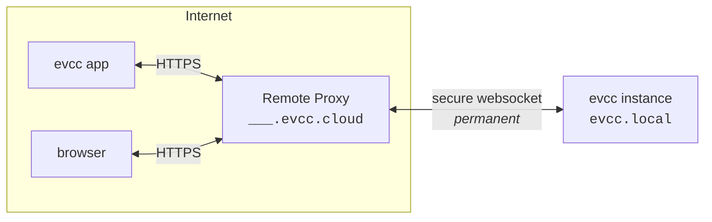

import { Steps } from "@astrojs/starlight/components";
import SponsorInfoBox from "@components/SponsorInfoBox.astro";
import statusImg from "@assets/features/remote-access/status.png";
import clientsImg from "@assets/features/remote-access/clients.png";
import clientCreatedImg from "@assets/features/remote-access/client-created.png";

Met toegang op afstand bereikt u uw evcc-installatie van buiten uw thuisnetwerk, via de [evcc-app](/nl/features/app) of een browser.
Uw installatie krijgt een eigen domein op `evcc.cloud`.
Port forwarding, dynamische DNS of een VPN zijn niet nodig, omdat de installatie de verbinding zelf uitgaand opbouwt.

<SponsorInfoBox lang="en" type="feature" />

## Instellen

<Steps>

1. Schakel de functie in onder **Configuratie → Toegang op afstand**.

   

2. Uw evcc-installatie maakt verbinding met `evcc.cloud` en krijgt een eigen domein, bijv. `swift-dark-crow.evcc.cloud`.

   

3. Maak voor elk apparaat dat toegang moet krijgen een aparte client aan.
   U krijgt een gebruikersnaam, een wachtwoord en een QR-code die beide bevat.
   - **App:** scan de QR-code met de camera van uw telefoon.
     De [evcc-app](/nl/features/app) opent en is direct verbonden.
   - **Browser:** open uw persoonlijke domein en meld u aan met gebruikersnaam en wachtwoord (basic auth via HTTPS).
   - **API-clients:** benader de API programmatisch met gebruikersnaam en wachtwoord.

     ```bash title="curl example"
     curl --user Macbook:7IIGKZGP-MV0PJKSE "https://swift-dark-crow.evcc.cloud/api/state?jq=.pvPower"
     ```

   

4. In hetzelfde overzicht ziet u welke clients het laatst actief waren en kunt u de toegang van afzonderlijke apparaten op elk moment intrekken.
   De toegang kan optioneel tot een vaste periode worden beperkt.

</Steps>

## Beveiliging

**Transport.**
Verzoeken aan uw domein lopen via HTTPS met het wildcardcertificaat voor `*.evcc.cloud`.
De verbinding tussen de Remote Proxy en uw lokale installatie loopt via een WebSocket-tunnel.

**Wat de Remote Proxy ziet.**
De Remote Proxy stuurt verzoeken alleen door.
De inhoud van verzoeken wordt niet opgeslagen of ingezien.
Per registratie worden alleen het domein, een hash van het verbindingstoken, de gekoppelde sponsor en tijdstempels bewaard, zodat de tunnel bij het opnieuw verbinden weer kan worden toegewezen.

**Lokale autorisatie.**
U maakt voor elk apparaat aparte inloggegevens aan.
Deze worden uitsluitend op uw evcc-installatie opgeslagen en gecontroleerd.
Op de Remote Proxy worden geen inloggegevens opgeslagen.
Het wachtwoord wordt maar één keer getoond, wanneer de client wordt aangemaakt.
Als u een apparaat verwijdert, wordt alleen de toegang van dat apparaat ingetrokken.
Alle andere apparaten blijven verbonden.
Herhaalde mislukte inlogpogingen worden automatisch afgeremd.

**Reikwijdte van de toegang.**
De inloggegevens voor toegang op afstand bestaan naast de eigen beveiligingsmechanismen van evcc.
Ze geven alleen netwerktoegang tot uw installatie, vergelijkbaar met toegang vanuit uw lokale netwerk.
Wijzigingen aan de configuratie, back-ups, logboeken of een herstart vereisen nog steeds het beheerderswachtwoord.

**Koppeling aan het sponsortoken.**
De registratie wordt gecontroleerd bij `sponsor.evcc.io`.
Elke sponsor krijgt precies één domein, dat permanent aan die sponsor is gekoppeld en nooit opnieuw wordt toegewezen.

## Technische details

Uw app of browser maakt verbinding met uw persoonlijke domein op `evcc.cloud`.
De Remote Proxy stuurt de verzoeken via een WebSocket-tunnel door naar uw lokale evcc-installatie.
Uw lokale installatie opent die tunnel zelf uitgaand, zodat er geen open poort in uw netwerk nodig is.



Bij de eerste activering registreert de lokale evcc-installatie zich bij de Remote Proxy.
In ruil voor het sponsortoken krijgt ze een verbindingstoken en een willekeurig toegewezen domein.
Beide worden lokaal opgeslagen en bij de volgende start opnieuw gebruikt om de tunnel te herstellen zonder opnieuw te registreren.

Bij latere starts opent de lokale evcc-installatie een blijvende, met TLS versleutelde WebSocket-verbinding (WSS) naar de Remote Proxy.
Deze verbinding dient als tunnel voor al het verdere verkeer en wordt uitgaand opgebouwd, zodat er geen port forwarding nodig is.

Bovenop deze verbinding fungeert [hashicorp/yamux](https://github.com/hashicorp/yamux) als multiplexer.
Elk inkomend HTTP-verzoek bij de Remote Proxy wordt een eigen yamux-stream bovenop de bestaande WebSocket-verbinding.
Meerdere gelijktijdige verzoeken delen één verbinding, zonder nieuwe TCP- of TLS-handshake per verzoek.

WebSocket-upgrades via de tunnel werken ook.
Dat is belangrijk, omdat de evcc-UI zelf live gegevens via WebSocket ontvangt.

Als de tunnel wegvalt, maakt de lokale installatie automatisch opnieuw verbinding.
Zolang de verbinding actief is, is uw domein bereikbaar, anders geeft de Remote Proxy een foutmelding.

De host van de Remote Proxy is standaard `api.evcc.cloud`.
Voor ontwikkeling of een zelf gehoste proxy kan deze worden overschreven met de omgevingsvariabele `EVCC_REMOTE_ACCESS`.

De broncode van de Remote Proxy wordt op een later moment gepubliceerd.
Details over privacy vindt u in onze [privacyverklaring](https://evcc.io/en/datenschutz/).
