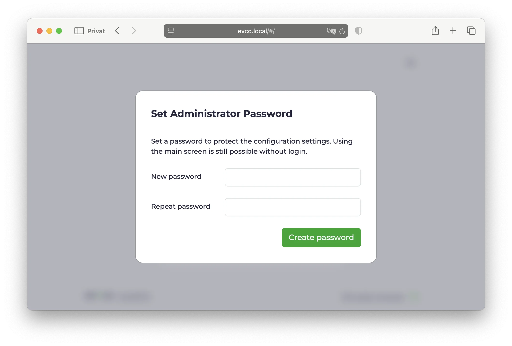
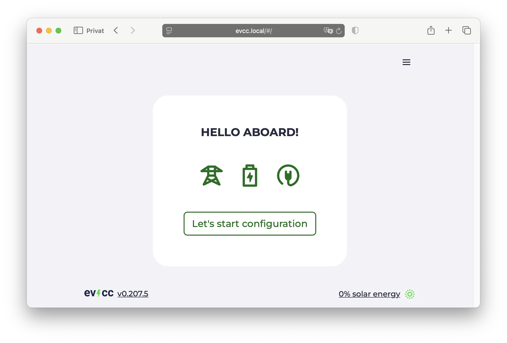
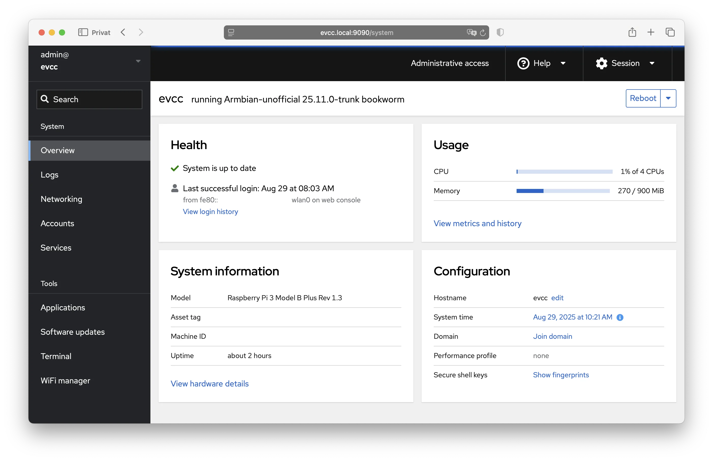

import { Steps } from "@astrojs/starlight/components";

De eenvoudigste manier om evcc op een Raspberry Pi of vergelijkbare singleboardcomputer te installeren.
Vooraf geconfigureerd en klaar om via de webinterface in te stellen!

## Snelstart

<Steps>

1. ### Bestand downloaden

   Download het nieuwste evcc-image voor uw apparaat:

   | Apparaat                             | Download                                                                                                                                                                                                                    |
   | ------------------------------------ | --------------------------------------------------------------------------------------------------------------------------------------------------------------------------------------------------------------------------- |
   | **Raspberry Pi** (3, 4, 5, Zero 2 W) | **[evcc_raspberry-pi.img.zip](https://github.com/evcc-io/images/releases/latest/download/evcc_raspberry-pi.img.zip)** ([SHA](https://github.com/evcc-io/images/releases/latest/download/evcc_raspberry-pi.img.sha))         |
   | NanoPi Zero2                         | [evcc_nanopi-zero2.img.zip](https://github.com/evcc-io/images/releases/latest/download/evcc_nanopi-zero2.img.zip) ([SHA](https://github.com/evcc-io/images/releases/latest/download/evcc_nanopi-zero2.img.sha))             |
   | NanoPi R3S                           | [evcc_nanopi-r3s.img.zip](https://github.com/evcc-io/images/releases/latest/download/evcc_nanopi-r3s.img.zip) ([SHA](https://github.com/evcc-io/images/releases/latest/download/evcc_nanopi-r3s.img.sha))                   |
   | NanoPi R76S                          | [evcc_nanopi-r76s.img.zip](https://github.com/evcc-io/images/releases/latest/download/evcc_nanopi-r76s.img.zip) ([SHA](https://github.com/evcc-io/images/releases/latest/download/evcc_nanopi-r76s.img.sha))                |
   | NanoPi NEO3 Plus                     | [evcc_nanopi-neo3-plus.img.zip](https://github.com/evcc-io/images/releases/latest/download/evcc_nanopi-neo3-plus.img.zip) ([SHA](https://github.com/evcc-io/images/releases/latest/download/evcc_nanopi-neo3-plus.img.sha)) |
   | NanoPi R28S                          | [evcc_nanopi-r28s.img.zip](https://github.com/evcc-io/images/releases/latest/download/evcc_nanopi-r28s.img.zip) ([SHA](https://github.com/evcc-io/images/releases/latest/download/evcc_nanopi-r28s.img.sha))                |

   Meer details per board (wifi, opslag, prestaties) vindt u in de [lijst met ondersteunde boards](https://github.com/evcc-io/images#supported-boards).

2. ### SD-kaart flashen

   Schrijf nu het gedownloade image naar de SD-kaart. Wij gebruiken hiervoor **[Armbian Imager](https://imager.armbian.com/#downloads)**. Als alternatief kunt u [Rufus](https://rufus.ie/) (Windows) gebruiken.
   - SD-kaart in de computer steken
   - Armbian Imager openen
   - **Use Custom Image** → gedownload bestand selecteren
   - Uw SD-kaart selecteren
   - Flashen starten → wachten tot het klaar is

   :::tip[Alternatief]
   In plaats van “Bestand downloaden & SD-kaart flashen” kunt u de SD-kaart ook met de **[Raspberry Pi Imager](https://www.raspberrypi.com/software/)** voorbereiden.

   Het evcc-image staat in de officiële catalogus. Selecteer **Choose OS → Other specific-purpose OS → Home assistants and home automation → evcc**.
   :::

3. ### Raspberry Pi starten
   - SD-kaart in de Raspberry Pi steken
   - Netwerkkabel aansluiten (aanbevolen), als alternatief [wifi instellen](#wifi)
   - Voedingsadapter aansluiten
   - Wachten tot hij is opgestart

4. ### evcc Web UI

   
   - Browser openen
   - **[https://evcc.local/](https://evcc.local/)** invoeren
     - Certificaatwaarschuwing accepteren (dat is normaal, de verbinding is wel versleuteld)
     - Als alternatief via IP-adres, bijv. `https://192.168.1.123/` (IP-adres in de router opzoeken)
   - Beheerderswachtwoord instellen (bij de eerste start)
   - Apparaten instellen (lader, zonnepanelensysteem, thuisbatterij, voertuigen)
     - Let op: er moet minimaal één laadpunt worden aangemaakt, anders draait evcc niet.

   Meer details over het instellen vindt u in de [configuratiehandleiding](/nl/installation/configuration).

   

   **Klaar!** 🎉

</Steps>

Systeemconfiguratie en updates gaan via [Cockpit](#cockpit).
Log daar eenmalig in om het standaard Linux-wachtwoord te wijzigen.

## Wifi instellen \{#wifi\}

Is er geen netwerkkabel beschikbaar, dan maakt de Raspberry Pi voor de eerste configuratie een wifihotspot aan.

- Zoek op uw smartphone naar het wifinetwerk **evcc-setup**
- Maak verbinding (geen wachtwoord nodig)
- Selecteer uw wifinetwerk thuis in de lijst
- Voer het wachtwoord van uw wifinetwerk thuis in
- De Raspberry Pi schakelt de hotspot uit en maakt verbinding met uw wifinetwerk thuis
- Ga verder met [evcc Web UI](#evcc-web-ui)

U kunt wifi ook later via [Cockpit](#cockpit) instellen.

## Systeembeheer via Cockpit \{#cockpit\}

Cockpit is een grafische interface voor systeembeheer onder Linux.
Hier kunt u uw systeem configureren, updates installeren en netwerkinstellingen wijzigen.

- URL: [https://evcc.local:9090/](https://evcc.local:9090/)
- Gebruiker: `admin`
- Wachtwoord: `admin` (standaard)

Bij de eerste keer inloggen wordt u gevraagd het standaardwachtwoord te wijzigen.
Kies een veilig wachtwoord voor het systeembeheer.
Vergeet u het, dan moet u de SD-kaart opnieuw flashen.
Er is geen functie “wachtwoord vergeten”.

**Belangrijke functies:**

- **System:** overzicht van CPU, geheugen en schijf
- **Logs:** [systeemlogs](/nl/report-a-problem#system-logs) bekijken
- **Networking:** netwerk en wifi configureren
- **Navigator:** bestandseditor voor configuratiebestanden
- **Terminal:** toegang tot de opdrachtregel
- **Software Updates:** systeem updaten

:::caution
**Het Cockpit-wachtwoord is alleen voor systeembeheer (incl. SSH).**

Voor de evcc-webinterface stelt u een apart beheerderswachtwoord in.
:::

## Hardware-aanbevelingen

evcc draait op diverse singleboardcomputers en heeft maar weinig systeembronnen nodig.
Zelfs 1 GB RAM is ruim voldoende.

**Ondersteunde apparaten:**

- Raspberry Pi 4 en 5: ruim voldoende prestaties
- Raspberry Pi 3 en Zero 2 W: voldoende als evcc de enige applicatie is
- NanoPi Zero2, R3S en R76S: compact, betaalbaar, verkrijgbaar met metalen behuizing en geïntegreerde eMMC-opslag

**Opslag:**
Minimaal een SD-kaart of eMMC van 16 GB.
Voor een langere levensduur raden we eMMC aan in plaats van een SD-kaart (bijv. bij de NanoPi).
SD-kaarten kunnen door veelvuldige schrijfbewerkingen slijten.
Zie ook de [aanbevelingen van Armbian](https://docs.armbian.com/User-Guide_Getting-Started/#what-do-i-need).

**Voeding:**
Gebruik de originele voeding van de betreffende fabrikant.

**Netwerk:**
Een bekabelde verbinding wordt sterk aanbevolen.
Wifi is mogelijk, maar vaak minder stabiel.

## Over het Linux-image van evcc

Het Linux-image van evcc is gebaseerd op [Armbian](https://www.armbian.com/) en biedt enkele praktische functies:

### Beschikbare services

| Service           | URL                                                       | Opmerking                                   |
| ----------------- | --------------------------------------------------------- | ------------------------------------------- |
| evcc-webinterface | `https://evcc.local/`                                     | zelfondertekend certificaat **(standaard)** |
|                   | `http://evcc.local:7070/`                                 | onversleuteld                               |
| OCPP-server       | `ws://evcc.local:8887/<station-id>`                       | onversleuteld **(standaard)**               |
|                   | `wss://evcc.local:8888/<station-id>`                      | zelfondertekend certificaat                 |
| Cockpit           | `https://evcc.local:9090/` (standaardwachtwoord: `admin`) | zelfondertekend certificaat                 |
| SSH               | `ssh admin@evcc.local` (standaardwachtwoord: `admin`)     |                                             |

Het image biedt voor alle services een versleutelde variant.
We raden aan om ook in lokale netwerken versleutelde verbindingen te gebruiken.
Bij OCPP ondersteunen sommige laders geen zelfondertekende certificaten.
Gebruik dan onversleuteld WS als terugvaloptie.

### Updates

- Besturingssysteem: beveiligingsupdates worden automatisch geïnstalleerd
- evcc: updates kunnen handmatig via [Cockpit](#cockpit) worden uitgevoerd

### SSH-toegang

U kunt via SSH inloggen als gebruiker `admin` (zelfde inloggegevens als bij [Cockpit](#cockpit)).

Meer technische details vindt u in de [GitHub-repository](https://github.com/evcc-io/images).

## Volgende stappen

In het gedeelte [Functies](/nl/features/solar-charging) leest u over alle mogelijkheden van evcc.
Download ook de [iOS/Android-app](/nl/features/app).
