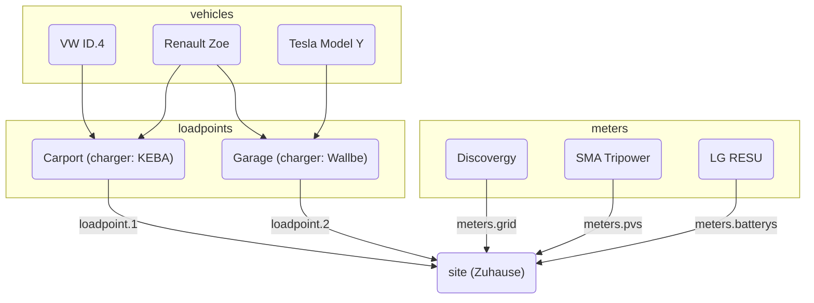

evcc kan op twee manieren worden geconfigureerd:

**1. Configuratie via de UI (aanbevolen)**

De configuratie gebeurt via de webinterface onder **Configuratie**.
Instellingen worden automatisch in de database opgeslagen.
Meer informatie vindt u onder [Configuratie](/nl/installation/configuration).

**2. Configuratie via een bestand**

Configuratie via het bestand `evcc.yaml` wordt nog steeds ondersteund.
Deze sectie beschrijft de configuratie op basis van YAML.

:::note[Parallel gebruik]
Beide configuratiemethoden kunnen naast elkaar worden gebruikt.
Apparaten (laadpunten, meters, zonnepanelensystemen, thuisbatterijen, voertuigen) worden uit beide bronnen samengevoegd.
Voor andere instellingen heeft de configuratie via de UI voorrang.
Details vindt u in de [FAQ](/nl/faq#ui-migration).
:::

## Configuratie via een bestand (evcc.yaml)

Het configuratiebestand is in YAML-formaat geschreven en heet standaard `evcc.yaml`.
Het staat in dezelfde map als evcc zelf of, op POSIX-systemen (bijv. Linux), in `/etc/evcc.yaml`.

Een afwijkend pad kunt u bij het starten opgeven: `evcc -c /path/to/evcc.yaml`

### Opbouw

Het configuratiebestand bestaat uit meerdere secties.
Apparaten hebben een parameter `name`, zodat de secties naar elkaar kunnen verwijzen.

Een voorbeeldbestand met veel parameters vindt u hier:
https://github.com/evcc-io/evcc/blob/master/evcc.dist.yaml

Hier volgt een overzicht van hoe de belangrijkste onderdelen van de
configuratie samenhangen:

### Hoe werkt evcc? (een kijkje onder de motorkap)

Voor de werking van het systeem is een elektriciteitsmeter belangrijk. Daarmee
kan op elk moment het overschotvermogen worden berekend. Het meten van het
opgewekte vermogen is interessant, maar heeft geen invloed op de werking, met
[deze uitzondering](/nl/faq#configuration).

Het overschotvermogen wordt vergeleken met het minimale vermogen dat nodig is om te laden. Is
dit voldoende, dan start het laden.

Het minimale vermogen om te laden wordt berekend uit de waarden `minCurrent`
en `phases`, die per `loadpoint` (een groep laders op dezelfde plek) worden gedefinieerd.
Zie [`loadpoints`](/nl/reference/configuration/loadpoints) voor meer
informatie.

Bijvoorbeeld: `phases: 1` en `minCurrent: 8`

1 (fasen) x 8 A (minCurrent) x 230 V (netspanning) = 1.840 W (minimaal vermogen om te laden)

#### Mogelijkheden om bij te sturen

Normaal komt het overschotvermogen overeen met het beschikbare laadvermogen.
Het beschikbare laadvermogen kunt u echter met
de volgende parameters naar wens aanpassen:

- Locatie: `residualpower`
- Locatie: `prioritySoc`
- Locatie: `bufferSoc`
- Locatie: `aux`
- Laadpunt: `enable: threshold`
- Laadpunt: `disable: threshold`

Raadpleeg de beschrijving van de betreffende parameter voor de mogelijke
instellingen.

- [Configuratieparameters van de locatie](/nl/reference/configuration/site)
- [Configuratieparameters van het laadpunt](/nl/reference/configuration/loadpoints)

### Locatie

Een [locatie](/nl/reference/configuration/site) beschrijft uw thuisinstallatie met de apparaten die evcc gebruikt,
en regelt het beschikbare vermogen.

### Laadpunt

Een [laadpunt](/nl/reference/configuration/loadpoints) beschrijft de laadinfrastructuur en combineert
de aanwezige _laders_, _voertuigen_ en alles wat een laadpunt verder nodig heeft.

### Laders

De sectie [Laders](/nl/reference/configuration/chargers) bevat een lijst met laders en hun eigenschappen, zoals
de manier waarop evcc ermee communiceert.

### Meters

De sectie [Meters](/nl/reference/configuration/meters) bevat een lijst met apparaten die verschillende energiestromen meten. Daartoe
behoren:

- Vermogen van netafname en teruglevering
- Door zonne-energie opgewekt vermogen
- Laadstroom van de elektrische auto (als de lader dit niet zelf ondersteunt)
- Energiestroom van de thuisbatterij(en)

### Opwekbegrenzers

[Opwekbegrenzers](/nl/reference/configuration/curtailers) zijn apparaten die alleen de teruglevering van het zonnepanelensysteem
op verzoek van de netbeheerder begrenzen (§ 9 EEG), bijv. de SMA Sunny Home Manager 2.0 of de master-omvormer
van een installatie met meerdere omvormers.

### Voertuigen

Om het laden van elektrische auto’s tot een bepaald laadniveau te begrenzen, kunt u hier
de aanwezige [voertuigen](/nl/reference/configuration/vehicles) en online toegangsgegevens opgeven.

### HEMS

evcc kan de laadpunten en hun laadstromen doorgeven aan een ander
[Home Energy Management System (HEMS)](/nl/reference/configuration/hems), zodat dat systeem deze
informatie kan gebruiken, bijv. om de thuisbatterij aan te sturen.

### Meldingen

In deze sectie kunt u gebeurtenissen definiëren waarover u geïnformeerd wilt worden. Voor
het versturen van berichten worden veel verschillende systemen ondersteund.

[Meer informatie](/nl/reference/configuration/messaging)
